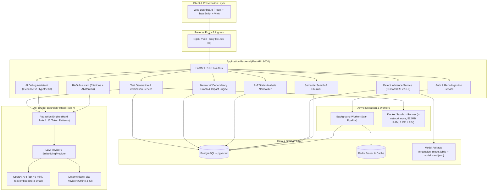

# RepoPilot AI

[](#test-suite--quality-verification)
[](apps/api/)
[](apps/web/)
[](apps/api/)
[](apps/web/)
[](https://github.com/astral-sh/ruff)
[](https://mypy.readthedocs.io/)

RepoPilot AI connects to a Python repository, indexes its code structure via Tree-sitter AST, answers technical queries with grounded RAG and bracketed line citations `[file:lines]`, predicts defect risk using trained scikit-learn and XGBoost models, surfaces static code findings via Ruff, maps dependencies and calculates blast radius using NetworkX, diagnoses findings via an AI Debug Assistant, and executes AI-generated pytest suites in a hardened Docker sandbox.

---

## Key Capabilities

1. **AST Parsing & Code Metrics (Phase 1)**:
   - C-level Tree-sitter parsing (`tree-sitter-python`) extracting classes, functions, decorators, parameters, and imports without code execution.
   - Radon code metrics: lines of code (LOC/SLOC), cyclomatic complexity ($v(g)$), Halstead metrics suite, Maintainability Index (MI), and function/module fan-in & fan-out.
2. **Symbol-Aware Code Search & Grounded RAG (Phase 2)**:
   - Symbol-based code chunker preserving function/class boundaries with fallback sliding windows.
   - PostgreSQL `pgvector` HNSW index for cosine distance vector similarity search.
   - Grounded conversational assistant with bracketed citations `[file:start-end]` and automatic abstention thresholding (`"Not enough evidence in the codebase to answer this question."`).
3. **Machine Learning Defect Risk Prediction (Phase 3)**:
   - Self-mined Python dataset (978 modules across 5 open-source repositories) via PyDriller and SZZ algorithm with radon AST features.
   - Leave-One-Project-Out (LOPO) cross-validation preventing intra-repository code style leakage.
   - Champion XGBoost / Random Forest models achieving **0.908 ROC-AUC** and **0.835 PR-AUC** (held-out cross-project test ROC-AUC **0.915** with 60% defect recall).
   - Probabilistic risk bands (`low`, `medium`, `high`) and top SHAP feature drivers with Rule 6 disclaimers.
4. **Static Analysis & Change Impact Engine (Phase 4)**:
   - Ruff static analysis runner in `--isolated` mode normalizing diagnostics into unified severity/category schemas.
   - Directed NetworkX dependency graph ($A \to B$ for $A$ imports $B$) computing shortest path chains, fan-out degrees, and DAG/cycle status.
   - Reverse reachability change impact engine simulating blast radius and impact tiers (`changed`, `direct`, `transitive`) in sub-20 milliseconds.
5. **AI Debug Assistant, Test Gen & Docker Sandbox (Phase 5)**:
   - Debug Assistant correlating static findings, code excerpts, and graph callers into strictly separated **EVIDENCE** (`source: static` / `graph_derived`) and **HYPOTHESIS** (`source: llm_generated`) sections.
   - Test Generation synthesizing standalone pytest unit and regression tests initially stored as `unvalidated`.
   - Hardened `DockerSandboxRunner` enforcing Hard Rule 3: `--network none`, `--memory 512m`, `--cpus 1.0`, `--security-opt no-new-privileges:true`, read-only workspace mount, and 20s timeout watchdog.
   - Credential scrubbing engine masking 12 secret families (`redact_secrets`) across LLM prompts and structured JSON application logs.

---

## System Architecture



---

## Folder Map & Monorepo Layout

```
repopilot/
├── apps/
│   ├── api/          # FastAPI REST API (auth, scans, RAG, defect risk, graph, tests)
│   ├── web/          # React + TypeScript UI (repository overview, chat, risk, graph)
│   └── worker/       # Asynchronous ingestion & scan worker
├── packages/
│   └── ml/           # Model training, LOPO cross-validation, and artifact exporter
├── demo/             # Turnkey demonstration repository & packaging tools
│   ├── sample_repo/  # Sample multi-tier Python project with intentional finding
│   ├── sample_repo.zip # Packaged demo repository for instant upload
│   └── package_demo.py # Script to rebuild demo package
├── docs/             # Architecture, decisions, backlog, progress, and eval reports
│   ├── ARCHITECTURE.md           # System design & Mermaid topology
│   ├── BACKLOG.md                # Phase-by-phase feature backlog
│   ├── PROGRESS.md               # Continuous audit trail of completed items
│   ├── RESUME_BULLETS.md         # Empirically measured resume bullets
│   ├── eval/                     # ML comparisons, retrieval benchmarks, datasheets
│   └── security/                 # Security pass & dependency vulnerability audit
├── infra/            # Docker Compose orchestration and Dockerfiles
├── tests/            # Root-level and cross-module automated verification tests
├── .env.example      # Environment variables template
└── AGENTS.md         # Operational guidelines and hard rules for AI agents
```

### Component Directory Summaries

| Directory | Type | Purpose & Technologies |
|---|---|---|
| [`apps/web`](apps/web/) | Application | React 18, TypeScript, Vite, TanStack Query |
| [`apps/api`](apps/api/) | Application | FastAPI, SQLAlchemy 2.x, Alembic, Pydantic v2 |
| [`apps/worker`](apps/worker/) | Application | RQ or Arq + Redis, Tree-sitter, Radon |
| [`packages/ml`](packages/ml/) | Package | scikit-learn, XGBoost, SHAP, PyDriller |
| [`infra`](infra/) | Infrastructure | Docker Compose, Dockerfiles, Postgres+pgvector, Redis |
| [`docs`](docs/) | Documentation | Architecture, decisions, data models, progress |

---

## Run Steps & Getting Started

### Prerequisites
- Python 3.12+
- Node.js 18+ & npm
- Docker and Docker Compose

### 1. Environment Setup
```bash
cp .env.example .env
```

### 2. Run with Docker Compose
```bash
docker compose up --build
```
This starts:
- **API Server**: `http://localhost:8000` (Swagger docs: `http://localhost:8000/docs`, Health: `http://localhost:8000/healthz`)
- **Web Dashboard**: `http://localhost:5173`
- **PostgreSQL (pgvector)**: port `5432`
- **Redis**: port `6379`
- **Background Worker**: connected to Redis queue

### 3. Local Development Mode

**Backend API:**
```bash
cd apps/api
source .venv/bin/activate
uvicorn app.main:app --reload --host 0.0.0.0 --port 8000
```

**Web Frontend:**
```bash
cd apps/web
npm install
npm run dev
```

---

## Turnkey Demo Repository Walkthrough

To experience RepoPilot AI immediately with a realistic multi-tier codebase:
1. Open the Web Dashboard at `http://localhost:5173`.
2. Under **Register New Repository**, select **Upload ZIP Archive**.
3. Choose the bundled demo package: [`demo/sample_repo.zip`](demo/sample_repo.zip).
4. Click **Connect** to trigger the automated 5-stage scan pipeline.
5. Explore the interactive dashboard:
   - **Repository Overview**: View LOC, cyclomatic complexity rank, Maintainability Index, and module coupling.
   - **Interactive Graph & Change Impact**: Select `app/database.py` and inspect downstream blast radius propagating through `app/auth.py` and `app/routes.py`.
   - **Static Findings**: Inspect the mutable default argument finding in `app/auth.py` (Ruff rule `B006`).
   - **Defect Risk Predictions**: View probability badges and top SHAP drivers for `app/payments.py`.
   - **RAG AI Assistant**: Ask *"How does authentication verify passwords?"* and inspect bracketed citations `[app/auth.py:20-25]`.
   - **AI Debug & Test Generation**: Generate unit test cases and run them in the isolated Docker sandbox.

---

## Test Suite & Quality Verification

Run the entire 285-test automated verification suite across monorepo root and backend:

```bash
# Run root-level and cross-module tests (142 tests)
apps/api/.venv/bin/pytest -q tests/

# Run backend API and unit test suite (143 tests)
cd apps/api && .venv/bin/pytest -q

# Run format and lint checks
cd apps/api && .venv/bin/ruff format . && .venv/bin/ruff check .

# Run strict type checking
cd apps/api && .venv/bin/mypy --strict app

# Run frontend production build
cd apps/web && npm run build
```

---

## Measured Benchmark Numbers

*Zero speculative claims. All numbers measured empirically:*

- **285 passing automated tests** across root, unit, integration, and E2E suites.
- **978 Python modules mined** across 5 open-source repositories using PyDriller and SZZ labeling for defect modeling.
- **0.908 ROC-AUC** and **0.835 PR-AUC** under Leave-One-Project-Out cross-validation on modern Python (Track B champion model).
- **0.864 Mean Reciprocal Rank (MRR)** and **97.1% Recall@10** on 35-query codebase retrieval benchmark (outperforming windowed chunking).
- **1.31 ms average retrieval latency** on vector search queries.
- **Sub-20 millisecond graph reachability** blast radius simulation across multi-tier dependency networks.
- **100% compliance with Hard Rule 5** source provenance labeling (`static`, `ml_predicted`, `graph_derived`, `llm_generated`).
- **12-pattern credential scrubber** masking private keys, AWS, GitHub, GitLab, Slack, Google, OpenAI, Anthropic tokens, JWTs, and database URLs.

---

## Documentation Links

- [System Architecture](docs/ARCHITECTURE.md) — Architectural design, pipeline flowcharts, sequence diagrams.
- [Feature Backlog](docs/BACKLOG.md) — Phased milestone tracking and acceptance criteria.
- [Progress Log](docs/PROGRESS.md) — Comprehensive record of all completed items.
- [Resume Bullets](docs/RESUME_BULLETS.md) — Resume-ready points from measured numbers only.
- [Evaluation Report](docs/eval/final_evaluation_report.md) — Master empirical benchmark synthesis.
- [ML Model Comparison](docs/eval/ml_model_comparison.md) — Track A vs Track B defect model benchmarks.
- [Security Pass Audit](docs/security/security_pass_audit.md) — Hard Rule 3 & 4 security and dependency review.
- [Architectural Decisions](docs/DECISIONS.md) — Locked design decisions and trade-offs.
