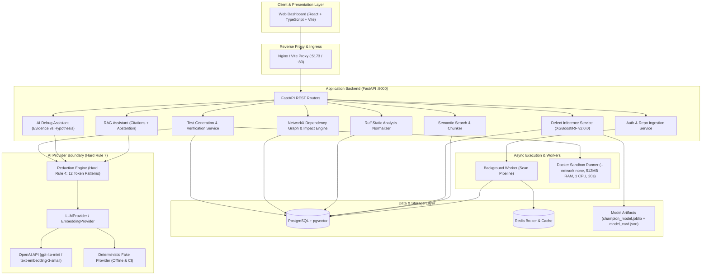
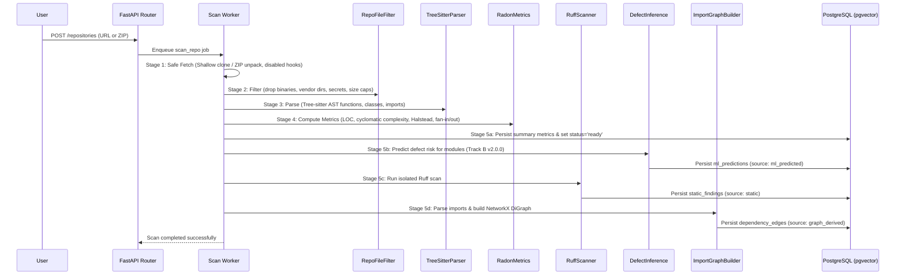

# RepoPilot AI — System Architecture & Design

RepoPilot AI connects to Python repositories, indexes their code structure via Tree-sitter AST, provides grounded conversational answers with bracketed line citations via RAG, estimates defect risk using trained scikit-learn/XGBoost models, surfaces static lint findings via Ruff, maps dependencies and calculates blast radius with NetworkX, diagnoses findings with an AI Debug Assistant, and executes AI-generated pytest suites in a constrained Docker sandbox.

---

## 1. System Topology & Architecture Diagram



---

## 2. Component Directory Layout

```
repopilot/
├── apps/
│   ├── api/
│   │   ├── alembic/                # Database migrations (Alembic)
│   │   ├── app/
│   │   │   ├── ai/                 # Providers, RAG service, Redaction engine, Debug assistant
│   │   │   ├── api/                # FastAPI REST endpoints (thin routers)
│   │   │   ├── core/               # Pydantic-settings config, structured JSON logging, DB session
│   │   │   ├── graph/              # NetworkX import graph builder, impact analysis, models
│   │   │   ├── indexing/           # Symbol & window chunker, pgvector search service, models
│   │   │   ├── ml/                 # Defect risk inference service, SHAP attribution, models
│   │   │   ├── parsing/            # Tree-sitter AST parser, radon metrics, models
│   │   │   ├── repos/              # Ingestion, safe shallow clone, file filter, scan service
│   │   │   ├── static/             # Ruff runner, diagnostic normalizer, models
│   │   │   └── tests_gen/          # Test generation service, Docker sandbox runner, models
│   │   └── tests/                  # 143 passing unit, integration, and API tests
│   ├── web/                        # React 18 + TS UI (Vite, Tailwind-styled components, TanStack Query)
│   │   ├── src/
│   │   │   ├── api/                # Typed API client with HTTP error handling
│   │   │   ├── pages/              # Repositories, Overview, Chat, Defect Risk, Graph Analysis
│   │   │   └── App.tsx             # React Router routing
│   │   └── package.json            # Web dependencies and build script
│   └── worker/                     # Asynchronous task worker skeleton
├── packages/
│   └── ml/                         # Standalone ML training and evaluation package
│       ├── artifacts/              # Serialized champion model (v2.0.0) & model_card.json
│       ├── data/                   # Authentic NASA (CM1, KC1) and mined Python dataset (v1)
│       ├── szz.py                  # PyDriller git commit miner & SZZ labeling
│       ├── track_b.py              # Multi-project dataset builder
│       ├── train_track_b.py        # Leave-One-Project-Out cross-validation runner
│       └── export_model.py         # Joblib pipeline exporter & model card generator
├── demo/                           # Turnkey demonstration repository & packaging tools
│   ├── sample_repo/                # Authentic multi-tier Python project with intentional finding
│   └── package_demo.py             # Automates zip creation for instant ingestion
├── docs/                           # Architecture, Decisions, Backlog, Progress, and Evaluation reports
├── infra/                          # Docker Compose, Dockerfiles, and reverse proxy configs
└── tests/                          # 142 root-level and cross-module automated verification tests
```

---

## 3. Core Architectural Pipelines

### 3.1 Repository Ingestion & Scan Pipeline (`scan_repo`)



### 3.2 Grounded Code Search & RAG Q&A (`POST /repositories/{id}/ask`)
1. **Secret Redaction**: Incoming query passes through `redact_secrets()` prior to processing.
2. **Embedding & Retrieval**: Vector similarity search on PostgreSQL pgvector (`cosine` distance) extracts top-k matching code chunks.
3. **Abstention Gate**: If top match score falls below `RAG_ABSTENTION_THRESHOLD` (default 0.35), the service immediately abstains: `"Not enough evidence in the codebase to answer this question."`
4. **Context Assembly**: Evidence blocks are formatted with strict identifiers `[file_path:start_line-end_line]`.
5. **Provider Completion**: Request is routed through `LLMProvider` interface to generate answers grounded strictly in the cited evidence.

### 3.3 Change Impact Analysis (`POST /repositories/{id}/graph/impact`)
1. Reverse reachability on directed dependency graph ($A \to B$ implies $A$ imports $B$, so changing $B$ impacts $A$).
2. Traversal computes shortest paths, fan-out blast radius, and categorizes impact tiers:
   - **Seed/Changed**: Depth 0.
   - **Direct Impact**: Depth 1 (immediate importers).
   - **Transitive Impact**: Depth $\ge 2$ (indirect callers).
3. Enforces cycle termination on cyclic dependencies and limits depth to `max_depth` (1..5).
4. Strictly labels output with `source: graph_derived`.

### 3.4 AI Debug Assistant (`POST /repositories/{id}/debug`)
1. Correlates static finding (Ruff rule, severity, code location) with code chunk context and NetworkX dependency callers.
2. Applies secret scrubbing (`redact_secrets`) across code and query.
3. Partitions output into:
   - **EVIDENCE**: Verified findings facts, code excerpt, and graph callers (`source: static` / `graph_derived`).
   - **HYPOTHESIS**: Probable root causes, suggested fix, code diff, regression risks on callers, and verification plan (`source: llm_generated`).

### 3.5 AI Test Generation & Docker Sandbox Execution (`POST /repositories/{id}/tests/{id}/run`)
1. Synthesizes pytest unit or regression test cases targeting specific symbols or findings.
2. Stores records in `generated_tests` with initial status `unvalidated` (`source: llm_generated`).
3. Executes test in `DockerSandboxRunner` enforcing Hard Rule 3:
   - `--network none` (network disabled).
   - `--memory 512m` and `--cpus 1.0` (resource limits).
   - `--security-opt no-new-privileges:true` (privilege escalation prevention).
   - Read-only workspace mount (`-v {dir}:/workspace:ro`).
   - Process timeout limit (20s).
4. Deterministic status transition:
   - Exit code 0 $\rightarrow$ `status: "passed"`
   - Exit code 1 (assertion failure) $\rightarrow$ `status: "failed"`
   - Exit code > 1 or timeout $\rightarrow$ `status: "error"`

---

## 4. Operational Hard Rules & Compliance

| Rule | Description | Implementation Details |
| :--- | :--- | :--- |
| **Rule 1** | One backlog item at a time | Sequential branches (`feat/P*-*`) merged into `main` after verification. |
| **Rule 2** | Every change ships with tests | 285 automated tests across unit, integration, and root E2E suites. |
| **Rule 3** | Untrusted repository code | Non-evaluating Tree-sitter AST, isolated Ruff, and sandboxed Docker runner. |
| **Rule 4** | Never log or send secrets/tokens | 12-pattern regex engine (`redact_secrets`), recursive dict scrubber, and structured JSON logger scrubbing. |
| **Rule 5** | Explicit source labeling | Every response schema tagged: `static`, `ml_predicted`, `graph_derived`, or `llm_generated`. |
| **Rule 6** | Probabilistic risk disclaimers | Defect predictions include model version (`v2.0.0`) and "risk estimates, never confirmed bugs" disclaimers. |
| **Rule 7** | Swappable AI provider layer | All LLM/embedding calls route strictly through `LLMProvider` / `EmbeddingProvider`. |
| **Rule 8** | Dependency justification | All additions documented with one-line justifications in commits and pyproject. |
| **Rule 9** | Schema changes via Alembic | 6 discrete Alembic migrations managing relational tables and indexes. |
| **Rule 10**| No requirement guessing | Ambiguities resolved through architecture specs and documented decisions. |
| **Rule 11**| ML Model Evaluation Reports | Comprehensive benchmarks and model comparisons documented in `docs/eval/`. |
